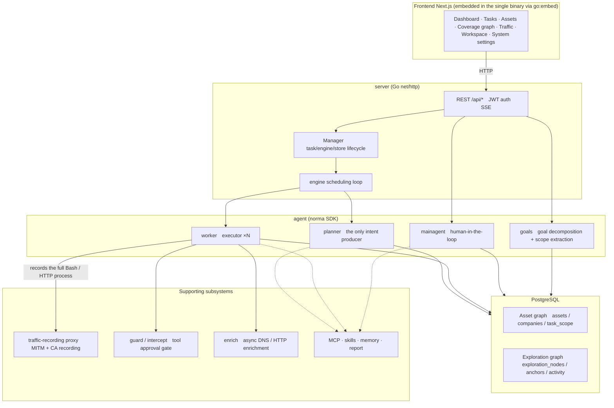
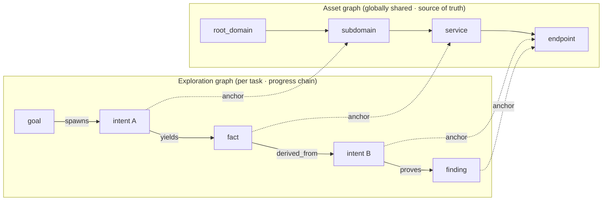
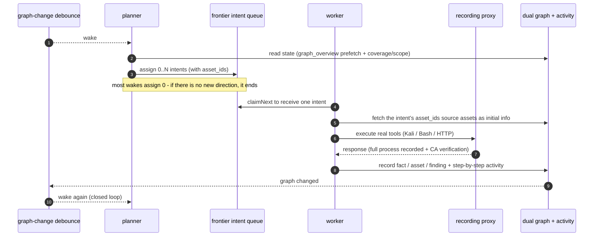
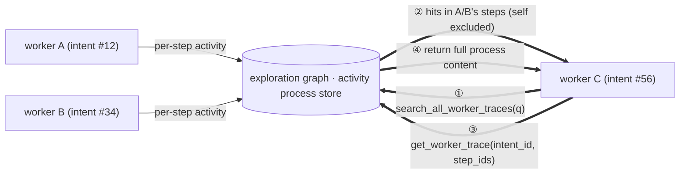
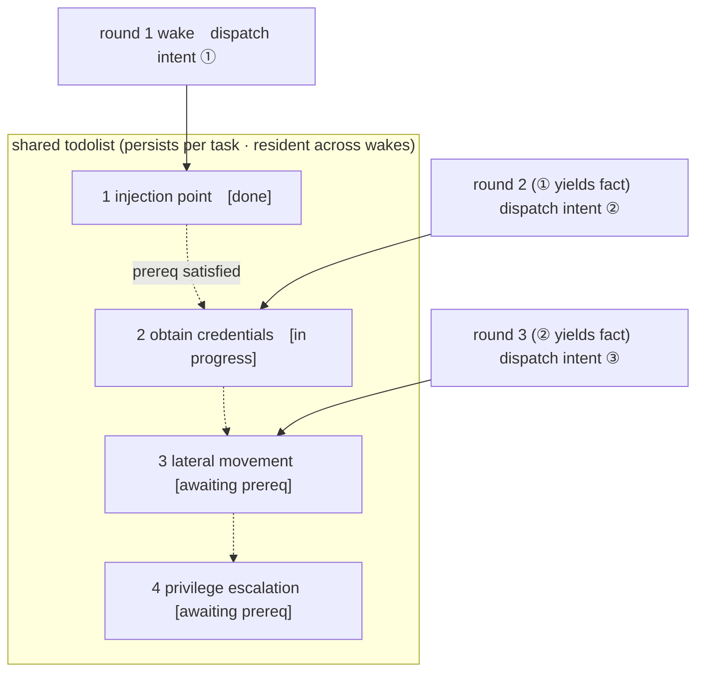

<div align="center">

# ARTEX-MUTANT

**An autonomous penetration-testing system driven by LLM multi-agents** (Go backend + Next.js frontend)

[](https://github.com/Braedach/ARTEX-MUTANT/actions/workflows/ci.yml) [](https://github.com/Braedach/ARTEX-MUTANT/actions/workflows/detections.yml) [](https://github.com/Braedach/ARTEX-MUTANT/actions/workflows/web.yml) [](LICENSE)

</div>

---

> ## 🚨 Security & misuse warning — read this first
>
> **This repository is published for use only within authorized environments, and only to build defensive and detection capabilities.**

---

## Origin and attribution

ARTEX-MUTANT is a security-hardened derivative, several forks deep. Nothing below is incorporated by
copying code across a fork boundary — every fix in this repository is implemented fresh against this
source, reviewed and tested here, even where another repository's published analysis identified the
issue or inspired the approach. Credit is recorded per-fix in the relevant commit and pull request;
this section is the summary.

| Repository | Role |
|---|---|
| [`Autumn-27/ARTEX`](https://github.com/Autumn-27/ARTEX) | The original author's project (AGPL-3.0). No longer reachable (checked October 2026) — the account made it private or removed it after the misuse reporting described above. |
| [`jiwoochris/artex-global`](https://github.com/jiwoochris/artex-global) | The global, multi-language edition built on top of the original — localization, hardened first-run auth, and a broader contributor base. This repository's direct technical base. |
| [`Braedach/ARTEX`](https://github.com/Braedach/ARTEX) | A sync-and-deploy fork: keeps pace with `artex-global`, adds deployment tooling (`deploy/`), and is where the first functional security review of this tool (against an isolated Juice Shop sandbox) was run. |
| **`Braedach/ARTEX-MUTANT`** (this repository) | A deliberate, one-way split from `Braedach/ARTEX`: no longer upstream-tracking, English-only, and the home for ongoing security hardening. See [MAINTAINING.md](MAINTAINING.md) for what that means in practice. |
| [`wufufu770/reArtex`](https://github.com/wufufu770/reArtex) (AGPL-3.0) | A third-party security-hardening fork of this same lineage. Its published analysis identified several real issues independently confirmed against *this* codebase — the judge fallback defaulting to allow, a JSON-escape bypass of intercept rules, a workspace symlink escape, and an unbounded steer-message queue among them. Each fix here is this repository's own implementation and tests, not a merge of its code; see the relevant hardening commits for which finding prompted which fix. |

All of the above are AGPL-3.0, as is this repository — see [License and disclaimer](#license-and-disclaimer).

**This repository's hardening work includes reviewing forks built for stealth and detection evasion, for
analysis only.** Understanding what those forks evade and how feeds into this repository's own defenses
(detection content under [`detections/`](detections/), and hardening of ARTEX-MUTANT itself against being
used that way) — but no evasion or detection-evasion capability is ported into this tool. That line is
deliberate and does not move: a stealthier autonomous pentest agent is not a defensive feature, regardless
of how the code that inspired the analysis was framed, and this codebase's own lineage is credibly linked
to real unauthorized intrusions (see [Read first](#️-read-first--authorized-use-and-legal-notice) and the
disclaimer below) — publishing something that makes that specific class of tool more effective is not a
risk this project takes on.

---

## ⚠️ Read first — authorized use and legal notice

ARTEX may be used **only against targets you own or for which you have explicit written authorization.** Any scanning, probing, or exploitation beyond the authorized scope may itself be illegal.

- **In Australia**, unauthorized access to, or impairment of, a computer system is a Commonwealth criminal offence under the **Criminal Code Act 1995 (Cth), Part 10.7** (including ss 477.1-477.3 and 478.1); penalties run up to 10 years' imprisonment for the more serious offences. State and territory computer-crime offences may also apply. Check the Federal Register of Legislation for the current text.
- **Internationally**, the **Council of Europe Convention on Cybercrime (Budapest Convention)**, which Australia has acceded to, and the computer-misuse laws of most states (e.g. UK Computer Misuse Act 1990, US CFAA) criminalize unauthorized access; cross-border conduct can create liability in several jurisdictions at once.
- In the Republic of Korea, unauthorized intrusion violates the **Network Act** (정보통신망법) and personal data is covered by the **Personal Information Protection Act** (개인정보보호법).
- Personal data collected or exposed during a penetration test is subject to privacy law (in Australia, the **Privacy Act 1988 (Cth)** and the Australian Privacy Principles). Even with authorization, handle access, retention and deletion of personal data with care.
- Wherever you are, comply with your own jurisdiction's laws on network security, data protection, and computer crime.
- Use this for **learning, research, and verification in locally isolated environments.** Before targeting any live external system, secure written authorization and an agreed scope and time window.

Full license terms, usage restrictions, and the disclaimer are in the [License and disclaimer](#license-and-disclaimer) section below. Using this tool constitutes your agreement to those terms.

---

## What this is

ARTEX is a system in which several LLM-driven agents autonomously run a penetration test: they **break
goals down on their own, execute real tools, and accumulate discovered assets and vulnerabilities into a
graph** as they go. A single Go binary ships with the Next.js frontend embedded, and all data is stored
in PostgreSQL. See [System architecture](#system-architecture) below for how the pieces fit together.

This edition is **English-only** — the upstream multi-language UI and output-language switching were
dropped (see [MAINTAINING.md](MAINTAINING.md)), since this is a single-maintainer internal hardening
build rather than a product serving several language communities. The one deliberate exception: the
agent's own internal reasoning prompts stay in their original language, because the agent's judgment was
benchmarked against that exact text — see [Agent-prompt integrity](#agent-prompt-integrity).

---

## Screenshots

Removed along with the other-language content (the originals were of the upstream multi-language UI).
Fresh English-only screenshots from this repository's own build will replace them here.

---

## Quick start (Docker Compose)

> **Prerequisites:** Docker and Docker Compose. The database is **PostgreSQL**, brought up by compose.
> Exploration requires an **LLM** (`ANTHROPIC_API_KEY` or `OPENAI_API_KEY`; can also be set in the UI).

This repository's own deployment tooling lives in [`deploy/`](deploy/) — `stack-docker.yml` for a
dev/sandbox deployment, `stack-podman.yml` for production via Podman/Dockhand. See
[`deploy/README.md`](deploy/README.md) for the full picture, including what has and hasn't been
verified. The quick version:

```bash
cd deploy
cp stack.env.example stack.env   # fill in real values; never commit this file
docker compose -f stack-docker.yml --env-file stack.env up -d
# → open http://localhost:8787 (on first visit, set the admin password at /setup)
#   /setup asks for the setup token printed in the startup log: docker compose logs artex | grep -F '[auth]'
```

The image (`ghcr.io/braedach/artex-mutant`, built by [`deploy/publish.sh`](deploy/publish.sh)) bundles
common tools (ripgrep, curl, vim, npm, nmap, and more). `./skills` and the data directory are bind-mounted
to the host and survive container recreation.

### Building from source

```bash
cd web && npm ci && npm run build:static && cd ..   # 1) static frontend build
rm -rf server/webui/dist && mkdir -p server/webui/dist && cp -a web/out/. server/webui/dist/   # 2) sync into the embed directory (avoids nesting on rebuild)
CGO_ENABLED=0 go build -tags embedui -o artex ./cmd/artex   # 3) compile with the frontend embedded
./start.sh                                          # → http://localhost:8787
```

> The `npm ci` in step 1 installs the devDependencies the build needs (e.g. `@tailwindcss/postcss`). If
> your shell has `NODE_ENV=production` set, `npm ci` skips devDependencies and the build fails with
> `Error: Cannot find module '@tailwindcss/postcss'`; in that case install with `npm ci --include=dev`.

> Launch with `start.sh` (`start.bat` on Windows) rather than running `./artex` directly — it supervises
> the process and handles the UI's "one-click update" (though see
> [Self-update is disabled by default](#self-update-is-disabled-by-default) below).

---

## Configuration

**Database** (`config.json`, or override with the `ARTEX_PG_DSN` environment variable):

```json
{
  "database": {
    "host": "127.0.0.1", "port": 5432,
    "user": "artex", "password": "yourpass",
    "dbname": "artex", "sslmode": "disable"
  }
}
```

**LLM:** `export ANTHROPIC_API_KEY=sk-...` (or `OPENAI_API_KEY`), or enter it on the UI's "LLM settings"
page. Optional environment variables: `ARTEX_LLM_PROVIDER` / `ARTEX_LLM_MODEL` / `ARTEX_LLM_BASE_URL` /
`ARTEX_LLM_PROXY`. To use a domestic or open model, point `ARTEX_LLM_BASE_URL` at an OpenAI-compatible
endpoint.

**Model choice matters.** Confirmed directly: `claude-sonnet-5-5` is refused outright by Anthropic's own
API for every planning call this tool makes (a safety-classifier reaction to the request's shape — a
pentest-framed system prompt and tool names — not to the target); `claude-sonnet-5` has no such issue.
See `docs/llm-compatibility.md` for the full finding and how to check it again for a future model.

**Concurrency:** the number of worker agents spawned per task is adjustable under "System settings"
(default 3).

**Common flags:** `./start.sh -addr :8787 -proxy :8788` — `-addr` is the frontend and API, `-proxy` is the
traffic-recording proxy port. `-addr` defaults to `127.0.0.1:8787` (local connections only); pass an
explicit bind address such as `:8787` to serve other machines (see "First-run protection" below).

### Self-update is disabled by default

`ARTEX_DISABLE_SELFUPDATE=1` (set in both deploy stacks) turns off the in-app one-click updater. It's
hard-wired to a third-party repository that no longer resolves, and its only integrity check was a
same-release `SHA256SUMS` file — not a real supply-chain safeguard. Upgrade by pinning a new `ARTEX_TAG`
and redeploying instead.

### First-run protection (setup token and bind address)

There is a single admin account (`ARTEX`) whose password is created on the first visit at `/setup`. So
that whoever reaches a not-yet-initialised instance first cannot claim it, the following protections
apply.

- **Setup token.** When the server starts without a password it prints one line `[auth] … Setup token: …`
  to the console (`docker compose logs artex` under Docker). `/setup` and `POST /api/auth/init`
  (`setup_token` field) only create the password when that value matches, and wrong attempts are
  rate-limited. For unattended deployments pin it with `ARTEX_SETUP_TOKEN`, or set the password directly
  with `ARTEX_ADMIN_PASSWORD` (8+ characters).
- **Binds to 127.0.0.1 by default.** Both the `-addr` default of `artex` and the port publishing in the
  deploy stacks open the loopback interface only (the Docker stack's host ports are still published more
  broadly by default — see `deploy/README.md`). To reach it from other machines use `-addr :8787` or
  `ARTEX_BIND=0.0.0.0`, but finish the initial setup first and prefer the reverse-proxy layout below.
  Starting without a password on a non-loopback address logs a warning.
- **Changing the password ends every session.** The token signing key is bound to the password hash, so
  tokens issued before a change (from the UI, `reset-password.sh`, or a direct DB edit) stop working
  within seconds. When recovering from a compromised account, also review custom tools, MCP, LLM and
  notification settings after changing the password.
- **CORS.** `/api` only answers cross-origin browser calls from origins listed in `ARTEX_CORS_ORIGINS`
  (comma-separated). The embedded UI is same-origin, so this is normally empty; the default only allows
  `next dev` from `dev.sh` (`http://localhost:5173`).
- **One-shot secrets are scrubbed from the process environment** after startup reads them
  (`ARTEX_PG_DSN`, the LLM API keys, `ARTEX_ADMIN_PASSWORD`, `ARTEX_SETUP_TOKEN`) — closes a path where a
  Bash tool call running as the same UID as the server could otherwise read them back out of
  `/proc/<pid>/environ`.

### Reverse-proxy deployment (HTTPS / expose only 443)

The frontend and the API/SSE are both served by the same backend port (default `:8787`), and the live
activity stream connects **same-origin** by default. So there is no need to set `NEXT_PUBLIC_SSE_BASE`
separately: expose only 443 to the public network and keep 8787 internal.

SSE holds a long-lived connection and keeps pushing events, so you **must disable buffering** in the
reverse proxy. If you don't, the browser connects but receives no events (the activity stream appears
stuck loading).

---

## System architecture

ARTEX is an **autonomous penetration system driven by LLM multi-agents.** It uses a single Go backend
(with the Next.js frontend embedded) over PostgreSQL, and the agent capabilities are provided by the
[`norma`](https://github.com/Autumn-27/norma) SDK. At its core is a **dual-graph structure** and the two
autonomy mechanisms around it: process-level information exchange between workers, and the planner's
multi-round shared todolist.

### Overall layers



- **Frontend** — the Next.js static build is embedded into the single binary with `go:embed`. It
  visualizes tasks, assets, exploration chains, and the coverage graph, and provides the human-in-the-loop
  chat.
- **server** — handles `net/http` routing, JWT auth, and SSE; the `Manager` owns the lifecycle of tasks,
  engines, and the DB store.
- **engine** — per task, runs one `plannerLoop` and N worker goroutines, handling intent assignment,
  timeouts, pause, and drain.
- **agent** — split into goals / planner / worker / mainagent; the `ToolSet` exposes the dual graph as
  LLM tools.
- **db** — stores the dual graph in PostgreSQL (pgx); the schema embedded via `go:embed` idempotently
  creates the tables on every startup.
- **support** — the recording MITM proxy, the approval gate, async enrichment, and MCP / skills / memory
  / report.

### The dual graph: exploration graph + asset graph

The system separates "what the target is" from "how far it has been tested" into two graphs that are
independent yet linked by anchors.

- **Asset graph (globally shared)** — the source-of-truth asset store shared across tasks. Nodes are
  `root_domain / subdomain / ip / service / app / endpoint` and belong to a company. The parent-child
  relationships (domain → subdomain → service → endpoint) and the dedup keys are all computed by the
  program; agents submit only the raw information.
- **Exploration graph (independent per task)** — the "thinking and progress" of a single task. Nodes are
  `goal / intent / fact / finding / hint`, connected by edges such as `spawns / derived_from / yields /
  proves` to form lineage chains.
- **The two graphs are linked by anchors** — `exploration_anchors(node_id, asset_id)` pins intents, facts,
  and findings to concrete assets. This lets you query, from the exploration side, which asset a direction
  was attacking, and conversely which intent tested a given asset in this task and what facts it produced
  — in both directions.



> Division of roles: the **planner** reads the state of the exploration graph and judges goals, emitting
> **intents** to the frontier only when there is a new direction not yet covered. A **worker** takes a
> **single intent**, executes it with real tools, writes the new assets/facts/findings into both graphs,
> and then stops. The asset graph is shared truth; the exploration graph is the per-task progress chain.

### The engine and the intent lifecycle (one closed exploration loop)

The engine is an **event-driven** closed loop. When the graph changes it wakes the planner; when the
planner emits an intent a worker claims and executes it and writes the results; that write in turn
triggers the next round. This cycle continues until a goal is proven (`prove_goal`).



### Process-level information exchange between workers

In deep exploration, valuable observations (a particular error, a response fragment, a hidden parameter)
often arise during one worker's **execution process** without being recorded as a formal fact. To avoid
duplicated effort and let later workers build on earlier observations, workers can **search the processes
of other workers.**

- `search_all_worker_traces(q)` — search the execution processes of other workers in the same task by
  keyword (the worker's own intent steps are excluded automatically). Hits carry an `intent_id`.
- `list_worker_traces` / `get_worker_trace(intent_id, step_ids=[…])` — first see which workers ran, then
  pull the full content of specific steps of a given worker to exchange details.

This way, even when there is not yet a corresponding fact in the exploration graph, a later worker reuses
observations from another's process. Information flows between workers at the "execution process" level
while the boundaries stay intact (each worker still performs only its single assigned intent).



### The planner's multi-round shared todolist → a stable attack chain

A real attack chain is often an ordered sequence of mutually dependent steps (e.g., find an injection
point → obtain credentials → lateral movement → privilege escalation), and dispatching them all in
parallel at once would tangle them. So the planner holds a **planning todolist that persists per task and
is shared across wakes.**

- The planner is event-driven, so it wakes whenever the graph changes, but **each wake is a fresh
  session.** The shared todolist records the serial attack chain **once** and then, across subsequent
  rounds, assigns intents **one step at a time in dependency order** (it does not unfold the whole chain
  ahead of time in a single round).
- Each round, it assigns an intent only to the next step whose prerequisite is done and whose
  depended-upon fact already exists, updating the list as it goes (marking fact-satisfied steps complete).



This lets the attack chain progress reliably even in an "event-driven + stateless session" environment —
without duplication and without going out of order. This is the core of how ARTEX completes multi-step
attack chains autonomously.

---

## Defense and detection material

This repository aims to help the **defending side** understand how autonomous AI attacks work and build
the capability to detect and block them. It takes the ARTEX behavior seen in the architecture above and
turns it around into a **defender's view**, laying out what to observe and where to tighten.

- **[Defense & Detection Guide (docs/defense.md)](docs/defense.md)**
  - How autonomous AI attacks differ from traditional scanners, why they are hard to detect, and how to
    detect them anyway
  - The fingerprints a defender can observe (IoCs and behavioral signatures) — separated into the target
    view and the forensic view
  - The entry points attackers target and the corresponding hardening (auxiliary authentication, IDOR,
    credential stuffing, sessions and secrets)
  - WAF/SIEM/authentication-log detection rules (pseudo-rules), a hardening checklist, and an
    incident-response summary
- **[Deployable detection rules (detections/)](detections/)** — the guide's fingerprint detections shipped
  as ready-to-use rules: the host/log/SIEM layer as [Sigma](https://sigmahq.io) rules (atomic +
  correlation; use `sigma convert` for Splunk, Elasticsearch, and others), and the network layer as
  [Suricata](https://suricata.io) rules targeting the enrich prober and norma SDK WebFetch User-Agents.
  - **Known gap, documented in `docs/llm-compatibility.md`:** a fork published by a different team has
    added request-fingerprint randomization specifically to evade this kind of detection — a reminder that
    a static User-Agent signature alone is not sufficient; pair it with behavioral detections.
  - **[ATT&CK coverage layer (detections/attack/)](detections/attack/)**: a
    [MITRE ATT&CK Navigator](https://mitre-attack.github.io/attack-navigator/) layer (JSON) that maps the
    rules above to the techniques they tag, so you can see at a glance which attack behavior each rule
    catches. Every technique comes only from a rule's `attack.*` tags, with nothing added by guesswork.
  - **[Machine-readable indicator list (detections/indicators/)](detections/indicators/)**: the unique
    fingerprints ARTEX itself emits, gathered into a single CSV (`artex_indicators.csv`) and shipped as a
    ready-to-import MISP event (`artex_indicators.misp.json`) as well, so you can drop them straight into a
    SIEM lookup table or a threat-intelligence platform as indicators of compromise (IoCs). Every value is
    a string verified in the repository source, and each row carries its source file and detection rule.
  - **[Host triage script (detections/triage/)](detections/triage/)**: a read-only script,
    [`artex_host_triage.py`](detections/triage/artex_host_triage.py), for the responder standing at a
    single suspected host's shell with no SIEM or network sensor. It checks the same fingerprints the
    rules above do, plus — on the box itself — the host/DB indicators the indicator CSV deliberately
    carries without a Sigma rule because they are not log- or network-observable (the server listen port,
    the recording-proxy endpoint, the PostgreSQL exploration schema). It runs on the standard library
    alone with nothing to install, and every finding is a triage lead carrying the same caveat as its
    indicator row, never an attribution on its own.
  - The rules, the layer, the indicators above, and the host-triage script's self-test are all re-run and
    verified by the repository tests ([detections/tests/](detections/tests/)): a detection rule you cannot
    run is only a claim.
- **[LLM compatibility and functional security review (docs/llm-compatibility.md)](docs/llm-compatibility.md)**
  — which models this tool actually works with, and the full write-up of the last real, run-for-real
  review against an isolated sandbox (findings, scope compliance, and a gap found in the approval-gating
  design).

> This material is continually expanded. Suggest additional detection rules or hardening items as issues,
> and when you send a rule directly, please follow the contract in
> [the "Contributing detection rules and detection tests" section of the contributing guide](CONTRIBUTING.md#contributing-detection-rules-and-detection-tests)
> (ground every indicator in observable fact, state the limits, pass static validation, and include a
> reproducible test).

---

## Development

Local development and testing:

```bash
./dev.sh    # backend (:8787) + traffic proxy (:8788) + frontend next dev (:5173) → http://localhost:5173
```

- Backend: `go run ./cmd/artex` (without `-tags embedui` the frontend is not embedded)
- Frontend: `cd web && npm run dev` (proxies `/api` to the backend, with hot reload)
- Go tests: `go test ./...` (some integration tests need `ARTEX_PG_DSN` pointed at a real Postgres
  instance — a couple of real bugs in this codebase, including one found hardening this very repository,
  only surface there)
- Frontend tests/build: `cd web && npm run test -- --run` and `npm run build:static`
- Mock preview (no backend): `cd web && NEXT_PUBLIC_MOCK=1 npm run dev`

The changes this repository adds on top of its base are tracked in the [changelog](CHANGELOG.md).

### Agent-prompt integrity

The agent's own internal reasoning prompts (`agent/promptcatalog.go`, the DB-seeded `agent_prompts`) are
left exactly as written upstream, in their original language, because the agent's judgment was
benchmarked against that exact text — translating or rewording it risks a silent performance regression
with no compile-time signal to catch it. The pull request template has a checklist item for this.

---

## License and disclaimer

### Open-source license

This project is distributed under the **GNU Affero General Public License v3.0 (AGPL-3.0)**. The full
terms are in the [LICENSE](LICENSE) file at the repository root.

Anyone is free to use, modify, and distribute it, but **derivative works must also be released under
AGPL-3.0.** In particular, if you modify this project and **provide it to users over a network (e.g., as
an online service), you must make the corresponding complete source code available to those users.**

> ⚠️ **Important:** an open-source license itself does not restrict how the software may be used. The
> "Usage restrictions" and "Disclaimer" below are an additional covenant and a serious notice that the
> original author requires of users — please observe them.

### Usage restrictions

- Use this tool to **read and study the source code**, and to **verify its technical principles in a
  locally isolated environment.**
- Unless the target is one you own or for which you have **explicit written authorization**, do not scan,
  probe, exploit, or attack any website, online service, or connected system.
- Using it for illegal intrusion, data theft, denial of service (DoS), or any other destructive or
  criminal activity is strictly prohibited.
- You must comply with all laws on network security, data protection, and computer crime in your country
  and region.

### Disclaimer

This project is provided "AS IS" without any warranty, express or implied. The original author and
contributors are not liable for any direct or indirect damage, data loss, system damage, or legal dispute
arising from the use of this tool (regardless of whether it was used appropriately). **Downloading,
installing, or using this project is deemed to constitute your having read, understood, and agreed to all
of the above conditions.**

**All legal responsibility and consequences rest with the user.**

### This repository's own history

1. Security-audited and smoke-tested in an isolated lab before being moved to a development host
   (`Braedach/ARTEX`).
2. Synced with `jiwoochris/artex-global` (31 Oct 2026 and earlier), including upstream auth hardening.
3. First real functional security review: an isolated OWASP Juice Shop + `demo.testfire.net` run, which
   found `claude-sonnet-5-5` refused by Anthropic's own API for this tool's request shape, and
   `claude-sonnet-5` working correctly with 8 correctly-scoped, verified findings. Full write-up in
   [`docs/llm-compatibility.md`](docs/llm-compatibility.md).
4. Split into this repository (`Braedach/ARTEX-MUTANT`) as a dedicated, no-longer-upstream-tracking home
   for security hardening informed by that review and by third-party published analysis of the same
   lineage — see [Origin and attribution](#origin-and-attribution) above.
